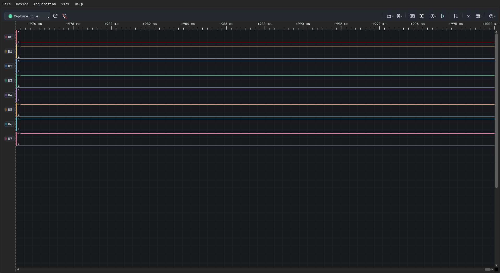

# U3LogicAnalyzer

U3LogicAnalyzer is a cross-platform PulseView-based host application for
USB logic analyzers. It keeps the full PulseView/libsigrok driver set and
adds support for newer analyzers, including WCH CH32H417/CH569 and
DreamSourceLab DSLogic devices using the v2 protocol.



## What it is

The application is based on PulseView 0.5.0 and bundles libsigrok,
libsigrokcxx and libsigrokdecode in-tree. It is not limited to one analyzer:
the bundled driver stack covers the same broad hardware support as
PulseView, plus the CH32H417/CH569 and DSLogic v2 additions.

The UI is English-only, uses a dark theme, and includes the sigrok protocol
decoders, so no external DSView installation is required.

## Supported hardware

- **All PulseView/libsigrok drivers included in the bundled stack**, for
  example:
  - Saleae Logic and other FX2LAFW analyzers
  - DreamSourceLab DSLogic / DSCope
  - Hantek, ASIX Sigma, Sysclk LWLA, ChronoVu, OLS, and more
  - Serial/SCPI instruments such as multimeters, power supplies and scopes
- **WCH CH32H417 and CH569** USB logic analyzers
- **DreamSourceLab DSLogic v2 protocol** devices:
  - DSLogic Plus
  - DSLogic U3Pro16
  - Other profiles supported by the driver

Some drivers are compiled only when their optional system libraries are
available. See the build scripts and `libsigrok` driver sources for details.

## Features

- Pan/zoom waveform viewer with per-channel H/L markers and row separators
- Configurable logic channel height, saved between sessions
- Device Options with hardware-specific settings:
  - DSLogic threshold, buffer/stream mode, RLE and channel modes
  - FX2LAFW 8-channel @ 24 MHz or 16-channel @ 12 MHz modes
  - WCH thresholds, ADC and channel configuration
- Trigger Option: simple per-channel trigger and multi-stage advanced trigger
- 130+ protocol decoders, discovered automatically
- Bundled firmware for DSLogic, FX2LAFW, ASIX Sigma and Sysclk LWLA1034
- USB hot-plug detection with automatic detach on unplug
- Linux, macOS and Windows build scripts; Linux CI builds and runs tests

## Build

Requirements: CMake 3.21+, a C++17 compiler, Qt6 (Widgets, Gui, Svg,
Network), glib/glibmm-2.4, Boost, libusb, hidapi, libzip and Python 3
development files. Optional driver dependencies are listed in the build
script for your platform.

Linux:

```bash
./build_linux.sh
./build_linux.sh --run
```

macOS:

```bash
./build_macos.sh
./build_macos.sh --run
```

Windows (MSYS2 UCRT64):

```bash
./build_windows.sh
```

The build installs the bundled libraries and firmware under
`build/linux/install` or `build/install`. The main binary is
`build/linux/pulseview_build/LogicAnalyzer` (Linux) or
`build/pulseview_build/LogicAnalyzer` (macOS).

## Firmware and USB access

All redistributable firmware is bundled in [`firmware/`](firmware/) and
installed into `share/sigrok-firmware`. DSView and
`sigrok-firmware-fx2lafw` are not required.

On Linux, USB access needs the libsigrok udev rules. The AUR package installs
them automatically; for a local build install:

```bash
sudo install -Dm644 libsigrok/contrib/60-libsigrok.rules \
   /usr/lib/udev/rules.d/60-libsigrok.rules
sudo install -Dm644 libsigrok/contrib/61-libsigrok-uaccess.rules \
   /usr/lib/udev/rules.d/61-libsigrok-uaccess.rules
sudo udevadm control --reload-rules
sudo udevadm trigger
```

Replug the analyzer after installing the rules.

Proprietary firmware that cannot be redistributed is not bundled. See
[`firmware/README.md`](firmware/README.md) for the inventory and extraction
instructions.

## CI and releases

The GitHub Actions workflow builds and tests on Linux. Pushing a `v*` tag
creates a Linux release archive. macOS and Windows build scripts are kept
for local use, but are not part of CI.

## Important notice

This is an independent community project. It is not affiliated with
PulseView, sigrok, Saleae, DreamSourceLab or WCH. Hardware behavior and
signal limits depend on the connected analyzer and its firmware. Verify
input voltage and wiring before connecting a device. Use at your own risk.

## License

This project, including the bundled libsigrok and libsigrokdecode trees, is
distributed under the GNU General Public License version 3 or later
(GPLv3+). The WCH-specific driver code is (C) Q2H2 under GPLv3+.

PulseView is also GPLv3+. Third-party resources (QDarkStyleSheet, DarkStyle,
QHexView, ExprTk, Tango icons and bundled firmware) retain their own licenses
and attributions. See the individual source files, `firmware/*/LICENSE` and
the original PulseView documentation for details.

## Credits

Based on PulseView 0.5.0 and the sigrok project. See the upstream project at
<https://sigrok.org/> and <https://github.com/sigrokproject/pulseview>.
