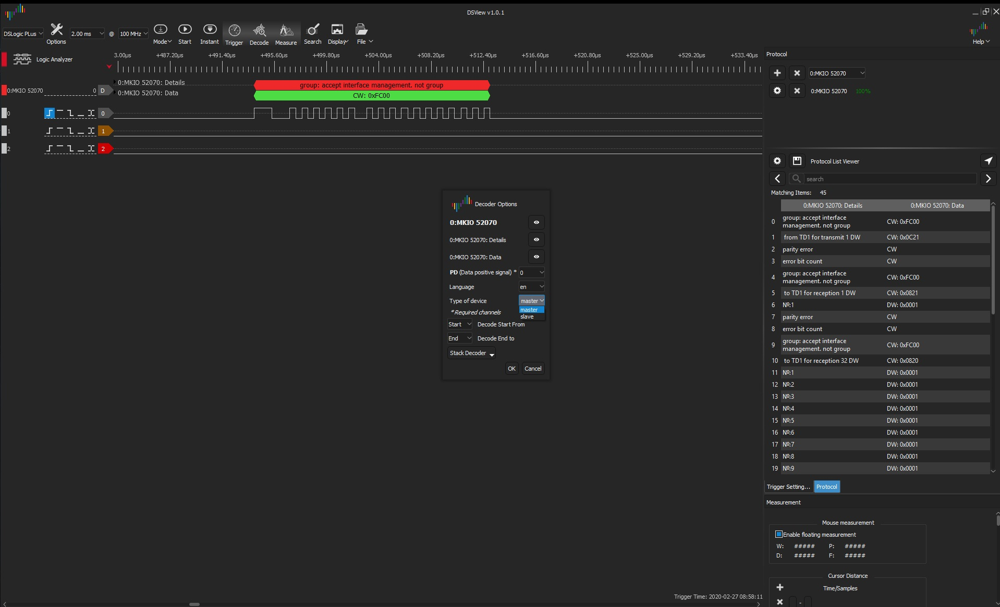
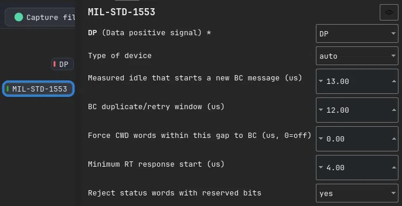

# MIL-STD-1553 decoder

A libsigrokdecode protocol decoder for the MIL-STD-1553 serial data bus.
It decodes the Manchester-encoded differential signal into command words
(CW), status words (SW), and data words (DW).




## Decoder options



### DP (Data positive signal)

Select the logic channel connected to the 1553 **Data Positive** line.
The decoder requires at least **4 MHz** sampling; below that it reports a
samplerate error instead of producing unreliable bits.

For a differential bus, use the positive side. The complementary signal is
not needed by this decoder.

### Type of device

Controls how command/status-sync words are interpreted.

| Value | Meaning |
|---|---|
| `auto` | Uses timing and transaction context to decide CW versus SW. Recommended for normal BC/RT traffic. |
| `master` | Treats every command/status-sync word as a BC command (`CW`). |
| `slave` | Treats every command/status-sync word as an RT status (`SW`). |

`auto` is required for captures containing both BC commands and RT status
words. `master` and `slave` are useful only for a capture known to contain
one direction.

### Measured idle that starts a new BC message (µs)

Default: **14.0 µs**.

If the edge-to-edge gap before a command/status-sync word is at least this
value, the word is treated as the start of a new BC message (`CW`).

This measurement includes roughly 2 µs of sync/edge overhead. A 12 µs wire
gap can therefore measure close to 14 µs.

Tradeoff:

- Lower value: a late RT status can be mistaken for a new command.
- Higher value: a closely spaced new BC command can be mistaken for a status.

### BC duplicate/retry window (µs)

Default: **14.0 µs**.

When the current word is identical to the previous command and arrives
within this window, it is treated as a **BC retry/duplicate command**, not as
a status.

This helps controllers that repeat a command before the RT response timeout.
A status value can be identical to the previous command value, so a large
retry window can misclassify that status as a repeated command. Set this to
`0` to effectively disable the duplicate-command heuristic.

### Force CWD words within this gap to BC (µs, 0 = off)

Default: **0** (off).

When nonzero, any command/status-sync word arriving within this gap is forced
to **BC command** (`CW`), regardless of the normal auto classification.

This is a blunt workaround for controllers that:

- send command words very close together, or
- ignore the normal RT response timing.

Leave it at `0` unless auto mode clearly misclassifies back-to-back commands.

The UI label says **CWD**; in 1553 terminology this is a **command word (CW)**.

### Minimum RT response start (µs)

Default: **4.0 µs**.

A word that appears sooner than this after the previous word cannot be a legal
RT response start, so it is treated as another **BC command**.

This covers:

- back-to-back BC commands
- the second command of an RT-to-RT transfer
- some duplicate/retry cases

### Reject status words with reserved bits

Default: **yes**.

MIL-STD-1553 status words have reserved bits **7..5**, which must be `000`.
With this enabled, a word with any of those bits set cannot be accepted as a
status and is treated as a command instead.

This prevents false status words such as `SW: 0x9F21`.

Disable it only for a non-compliant device that transmits reserved status
bits set.

## Auto classification order

In `auto` mode the decoder evaluates, in order:

1. Forced BC window (`Force CWD...`)
2. Gap shorter than the minimum RT response → BC command
3. RT-to-RT receive/transmit command pair → BC command
4. Status reserved bits set → command
5. Transaction already complete → new BC command
6. Long idle → new BC command
7. Status still expected and word is not a legal command → status
8. Exact duplicate of the previous command within the retry window → BC command
9. Previous word was a status → new BC command
10. Otherwise → RT status

The decoder also tracks how many status words are owed:

- normal BC-to-RT or RT-to-BC transfer: 1
- RT-to-RT transfer: 2
- broadcast: 0

## Recommended starting values

```text
Type of device: auto
Measured idle: 14.0
BC duplicate/retry window: 14.0
Force CW window: 0.0
Minimum RT response start: 4.0
Reject reserved status bits: yes
```

If a status word is being misread as a retry because its value equals the
previous command, set **BC duplicate/retry window** to `0`.

For debugging captures with unusually close back-to-back commands, try a
small force window, for example `2.0`–`4.0` µs.

## Output

- `CW` / `SW` / `DW` word values
- Command/status details row
- Data-word numbering
- Parity errors
- Bit-count errors
- MIL-STD-1553 mode-code names and validity warnings

## Limitations

- Serial (1553A/B serial mode-code) trigger decoding is not implemented.
- The decoder assumes Manchester encoding on the selected DP input.
- Auto mode uses timing heuristics; unusual controllers may require adjusting
  the timing options above.

## License

This decoder is part of the U3LogicAnalyzer project and is distributed under
the GNU GPL v3 or later.
